<div align="center">

# Nightmare Survival

**A top-down flashlight horror game that runs in your browser.**<br>
Restore the fuses, find the exit, keep your sanity. Something is still on shift.

[](https://0x0806.github.io/NIGHTMARE-SURVIVAL/)
[](#install-as-an-app-pwa)
[](#project-structure)

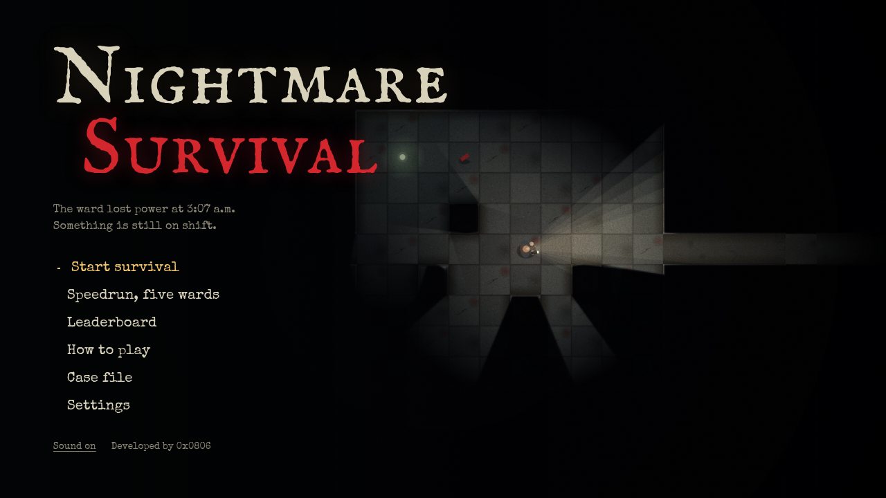

</div>

---

## Contents

- [About](#about)
- [Screenshots](#screenshots)
- [How it plays](#how-it-plays)
- [Controls](#controls)
- [Install as an app (PWA)](#install-as-an-app-pwa)
- [Run it yourself](#run-it-yourself)
- [How it works](#how-it-works)
- [Project structure](#project-structure)
- [Testing](#testing)
- [Credits](#credits)

## About

The ward lost power at 3:07 a.m. You have a torch with a dying battery, a few flares, and a job: collect every fuse, power the exit, and get out. Four kinds of things hunt you, and the only way to see them is to light them up.

Everything is generated at runtime. There are no image or audio files in the game: sprites are painted onto canvases on start-up, and all sound is synthesised with the Web Audio API. The whole game is three source files and runs on any modern browser, desktop or phone.

## Screenshots

<table>
  <tr>
    <td width="50%">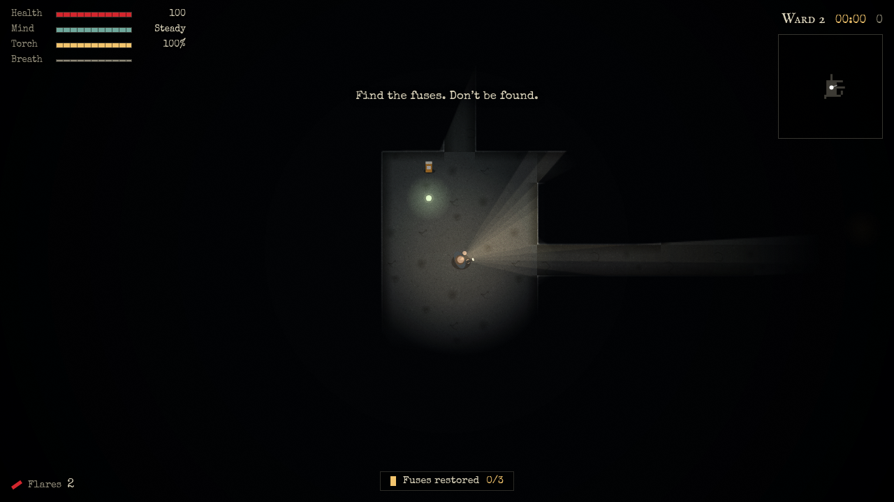<br><sub><b>Exploring.</b> Raycast lighting: walls and props cast real shadows, and the beam stops at corners.</sub></td>
    <td width="50%">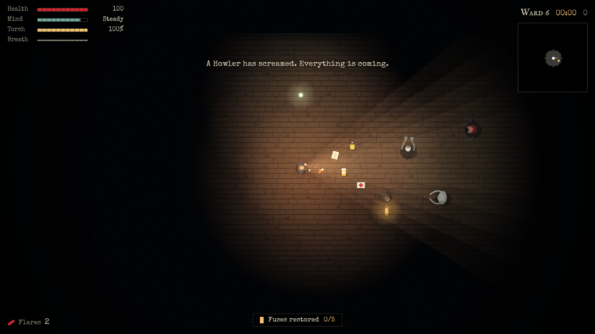<br><sub><b>Under pressure.</b> A flare lights the room and makes Crawlers scatter. The Howler has just screamed.</sub></td>
  </tr>
  <tr>
    <td>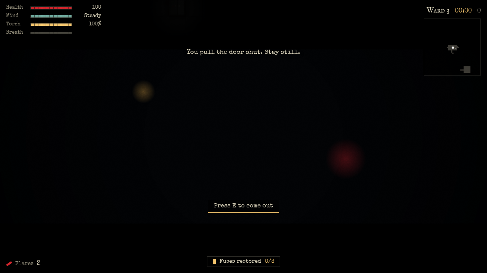<br><sub><b>Hiding.</b> In a locker you see only through the slats. Hunters lose you, but they will come and check.</sub></td>
    <td>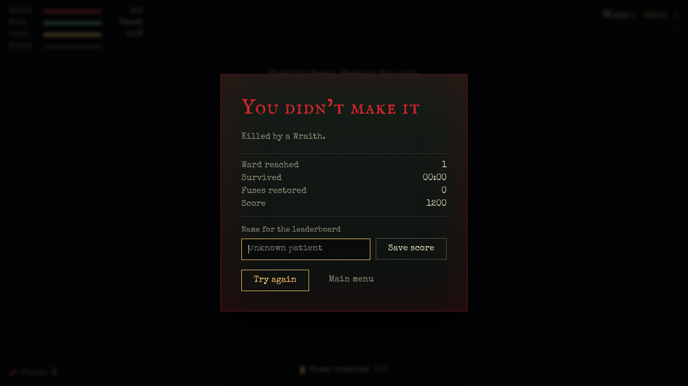<br><sub><b>Death.</b> Stats, the cause, and an optional name for the leaderboard.</sub></td>
  </tr>
  <tr>
    <td>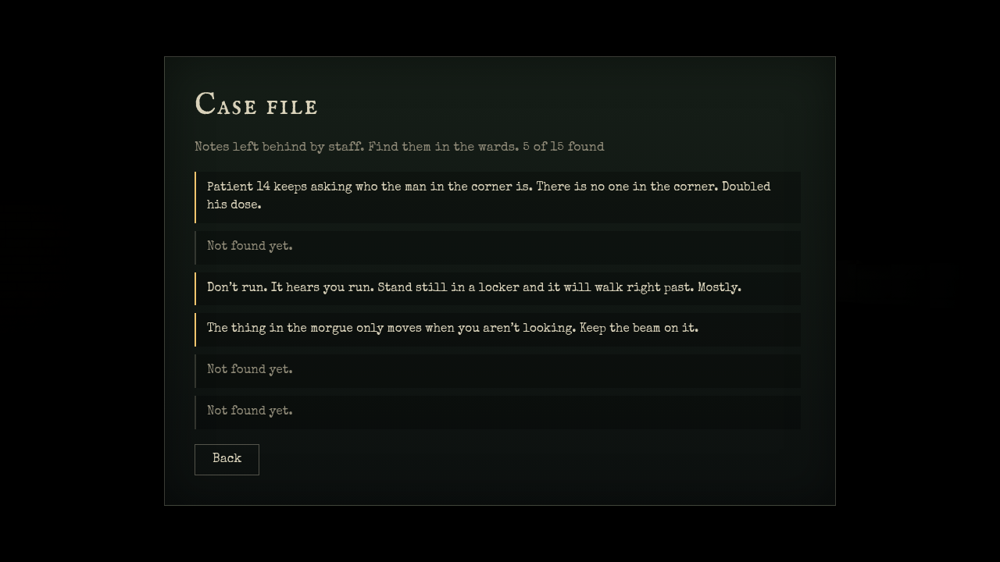<br><sub><b>Case file.</b> Each ward hides a note from the staff. Found notes are saved.</sub></td>
    <td>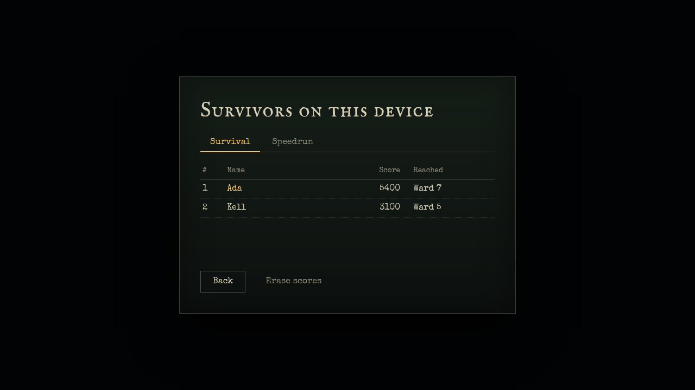<br><sub><b>Leaderboard.</b> Separate tables for Survival and Speedrun, stored on your device.</sub></td>
  </tr>
  <tr>
    <td>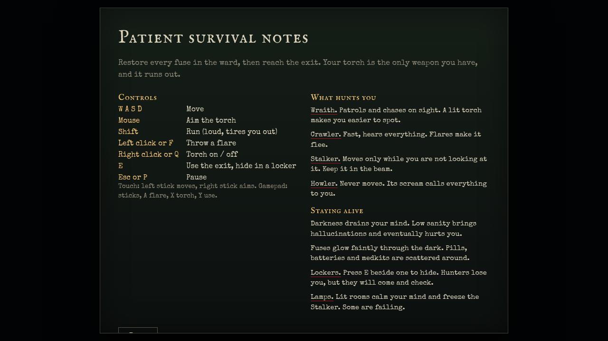<br><sub><b>How to play.</b> Controls and a field guide to what hunts you.</sub></td>
    <td>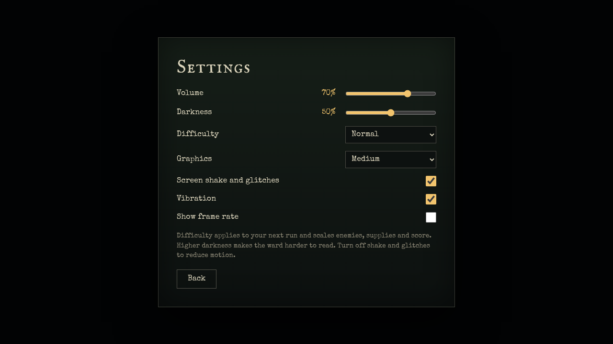<br><sub><b>Settings.</b> Difficulty, volume, darkness, graphics quality, motion and vibration.</sub></td>
  </tr>
</table>

<details>
<summary><b>On a phone</b></summary>
<br>
<p align="center">
  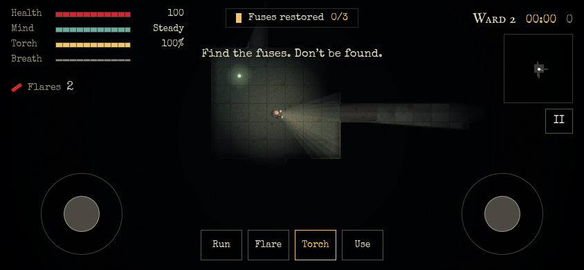
  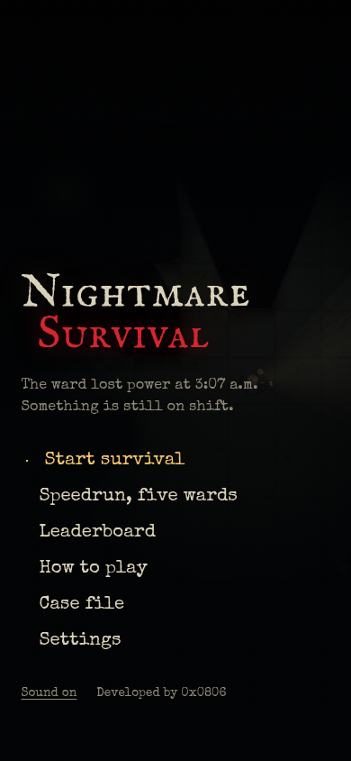
</p>
</details>

## How it plays

**Goal.** Collect every fuse in the ward, then reach the exit. Each ward is procedurally generated and larger than the last.

**Light is everything.** You only see what your torch, a flare or a lamp reaches. The battery drains. Fuses glow faintly through the dark so you can navigate toward them.

**What hunts you**

| Monster | Behaviour | Counter |
|---|---|---|
| **Wraith** | Patrols and chases on sight. Your torch makes you easier to spot. | Break line of sight, hide, or outrun it with care. |
| **Crawler** | Fast, and hears everything. | Flares make it flee. |
| **Stalker** | Moves only while it is out of your light. | Keep it in the beam, or stay in a lit room. |
| **Howler** | Never moves. Its scream pulls every hunter to you. | Stay out of its sight. |

**Systems**

- **Sanity.** Darkness and close encounters erode it. Low sanity brings a flickering torch, hallucinations and colour loss; at zero it starts to hurt you. Pills, flares and lamps restore it.
- **Noise.** Sprinting is loud, standing still is quiet, a thrown flare is loud. Enemies react to what they hear.
- **Lockers.** Press `E` beside one to hide. Hunters lose sight of you, but ones that come looking will find you if they stand next to the locker long enough.
- **Lamps.** Some rooms have a ceiling lamp. Lit rooms calm your mind and freeze the Stalker. Many of them are failing and flicker.
- **Case file.** Each ward hides a staff note. Collected notes are saved and readable from the menu.
- **Difficulty.** Easy, Normal or Nightmare scale enemy speed, supplies and score. A small director also nudges difficulty based on how you did in the last ward.

**Modes**

| Mode | Goal |
|---|---|
| Survival | Go as deep as you can. Score comes from wards, fuses, pickups and speed. |
| Speedrun | Clear five wards as fast as possible. Ranked by total time. |

Leaderboards are stored locally on your device. There is no server.

## Controls

| Input | Action |
|---|---|
| `W` `A` `S` `D` / arrow keys | Move |
| Mouse | Aim the torch |
| `Shift` | Run (loud, drains breath) |
| Left click / `F` / `Space` | Throw a flare |
| Right click / `Q` | Torch on / off |
| `E` | Use the exit, hide in a locker, come out |
| `Esc` / `P` | Pause |
| `M` | Mute |

**Touch:** left stick moves, right stick aims (the torch follows your movement when the aim stick is idle), buttons for Run, Flare, Torch and Use.
**Gamepad:** sticks move and aim, `A` flare, `X` torch, `Y` use, `Start` pause.

## Install as an app (PWA)

Nightmare Survival is a Progressive Web App: it can be installed, launches full-screen without browser chrome, and **works offline** after the first visit.

| Platform | How to install |
|---|---|
| Chrome / Edge (desktop) | Click **Install app** in the menu footer, or the install icon in the address bar. |
| Android (Chrome) | Click **Install app** in the menu footer, or use the browser menu and choose *Install app*. |
| iOS / iPadOS (Safari) | Tap **Share**, then **Add to Home Screen**. |

What the PWA setup includes:

- A web app manifest with PNG and SVG icons, a maskable icon, screenshots, and shortcuts (Survival, Speedrun).
- A service worker that precaches the whole game. Code (HTML, JS, CSS) is **network-first**, so updates arrive as soon as you are online; fonts and icons are cache-first.
- An in-game install button that uses the browser's install prompt where available.

## Run it yourself

There is no build step. Open `index.html` directly, or serve the folder (service workers need `http://` or `https://`):

```bash
git clone https://github.com/0x0806/NIGHTMARE-SURVIVAL.git
cd NIGHTMARE-SURVIVAL
python3 -m http.server 8000
# open http://localhost:8000
```

To publish your own copy, push to GitHub and enable **Settings → Pages → Deploy from a branch → `main` / root**. All asset paths are relative, so it works under a project sub-path.

When you change cached files, raise the `CACHE` version in `sw.js` so returning visitors pick up the new assets.

## How it works

| System | Approach |
|---|---|
| **Levels** | A seeded generator places rooms, joins them with corridors and loops, adds props that can never block a path, then puts the start and exit at opposite ends. Fuses, pickups, lamps, lockers and enemies are placed afterwards on reachable tiles. |
| **Lighting** | A grid-DDA raycaster builds visibility polygons for the torch, flares and lamps. These are cut out of a darkness layer, with warm tint added to the lit world. The same raycaster drives enemy line of sight and the Stalker's freeze rule. |
| **Enemy AI** | Patrol, investigate, chase and search states. Pathing uses breadth-first flow fields on the tile grid. Senses depend on distance, field of view, your torch, how fast you move, and whether you are hiding. |
| **Audio** | Entirely procedural Web Audio: layered drone and wind, a tension layer, a heartbeat tied to danger and health, positional growls, a pursuit pulse, and random distant events. No audio files. |
| **Rendering** | Canvas 2D. Floor, wall and prop sprites are baked once into small canvases. Grain, vignette, glitch bands and sanity desaturation are done in-canvas. Graphics quality scales light resolution and ray count, and the game lowers it for the session if the frame rate drops. |
| **Persistence** | `localStorage` for settings, leaderboards, name and collected notes, always behind try/catch so private browsing still works. |

## Project structure

```
index.html              Screens, HUD and touch controls
style.css               Interface styling and self-hosted font faces
script.js               Game: levels, lighting, AI, audio, rendering, UI
sw.js                   Service worker (offline support)
manifest.webmanifest    PWA manifest
404.html                Not-found page for GitHub Pages
fonts/                  IM Fell English SC and Special Elite (woff2)
icons/                  App icons, maskable icon, link-preview image
docs/screenshots/       Images used in this README
```

## Testing

There is no unit-test framework. During development the game was verified with scripted headless Chromium runs (the harness is not part of this repository):

- **Soak test.** A bot completes all 14 of the first wards with damage disabled, checking that every fuse, pickup and the exit is reachable and that no exception is thrown while rendering.
- **Mechanics.** Scripted checks that the Stalker freezes in the beam and attacks from behind, and that hiding in a locker works and keeps patrolling hunters from noticing you.
- **Live site.** The deployed GitHub Pages build is compared byte-for-byte with the repository and audited with Lighthouse.

## Credits

Designed and developed by **0x0806**.

Fonts: [IM Fell English SC](https://fonts.google.com/specimen/IM+Fell+English+SC) and [Special Elite](https://fonts.google.com/specimen/Special+Elite), used under the SIL Open Font License and self-hosted.
