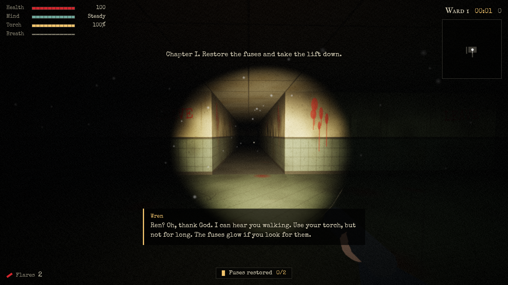
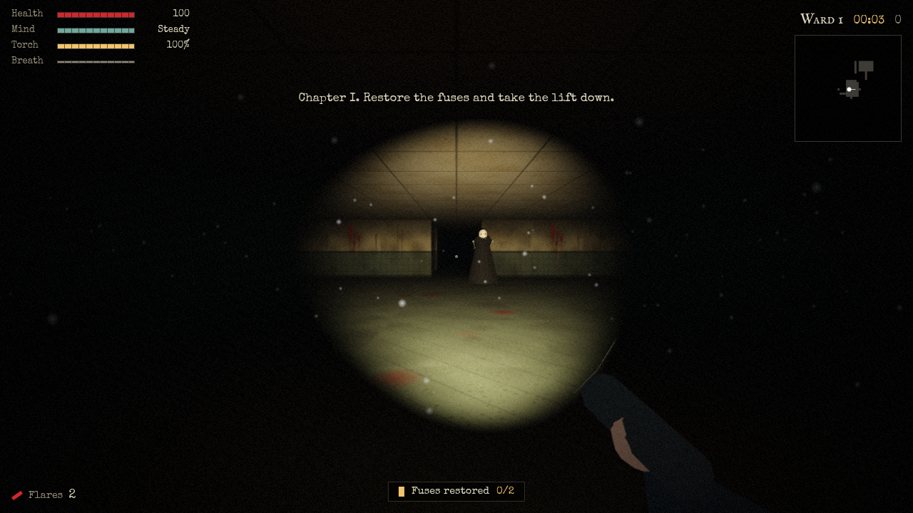
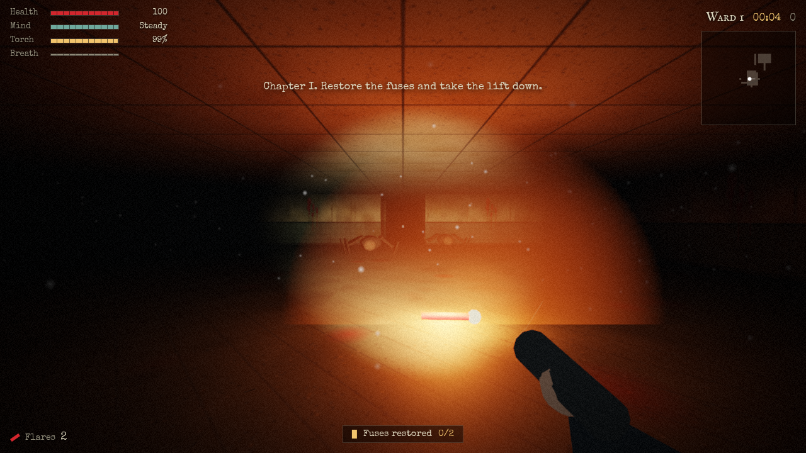
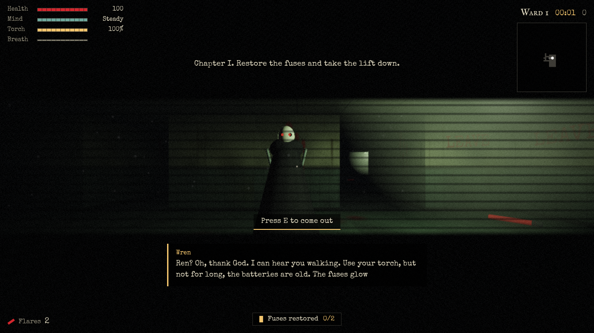
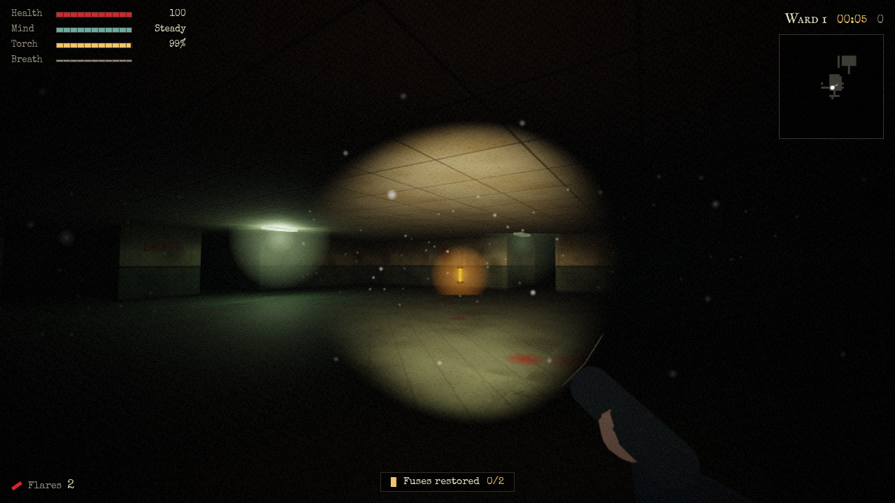
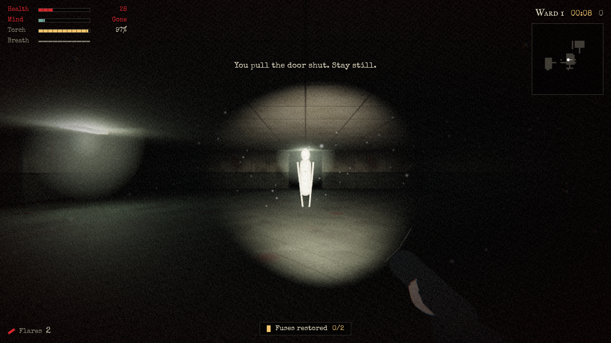
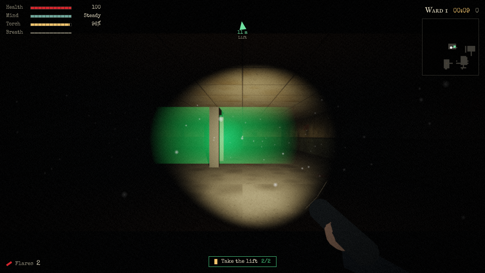
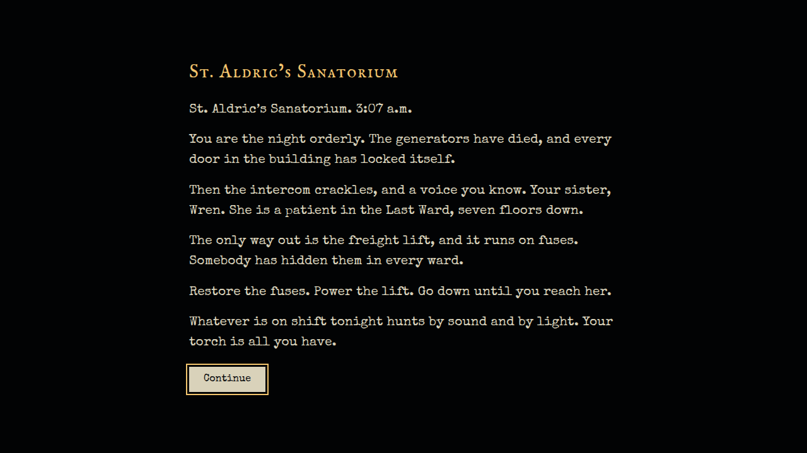
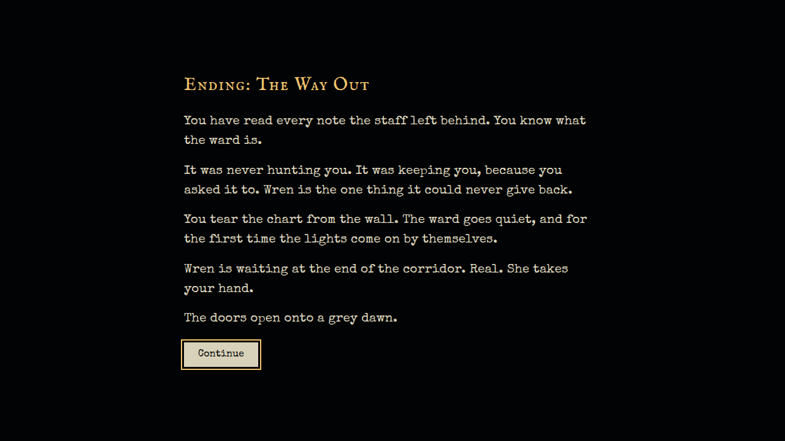
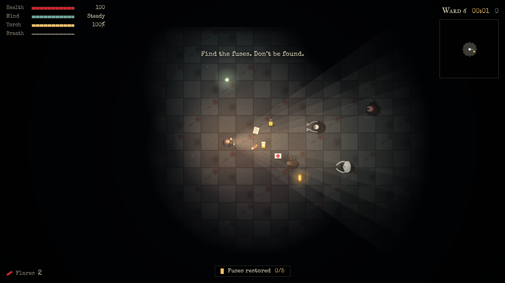

<div align="center">

# Nightmare Survival

**A first-person 3D horror game that runs in your browser.**<br>
Your sister is on the last floor. The lift needs fuses. Something is still on shift.

[](https://0x0806.github.io/NIGHTMARE-SURVIVAL/)
[](#install-as-an-app-pwa)
[](#how-it-works)



</div>

---

## Contents

[The story](#the-story) · [Screenshots](#screenshots) · [How it plays](#how-it-plays) · [How hard is it?](#how-hard-is-it) · [Controls](#controls) · [Install as an app](#install-as-an-app-pwa) · [Run it yourself](#run-it-yourself) · [How it works](#how-it-works) · [Testing](#testing) · [Credits](#credits)

## The story

St. Aldric's Sanatorium, 3:07 a.m. You are the night orderly. The generators have died and every door in the building has locked itself.

Then the intercom crackles, and it is a voice you know: your sister, **Wren**, a patient in the Last Ward, seven floors down. The only way out is the freight lift, and it runs on fuses that somebody hid in every ward.

You go down, one ward at a time, with Wren's voice on the radio guiding you, warning you, and slowly asking questions you can't answer. Why can't she find your name on the staff list? Whose handwriting is on the chart on her wall?

The game never leaves you guessing about *what to do*: each ward opens with a briefing and a message from Wren that teaches the mechanic you are about to need, and the top of the screen always tells you what the objective is. What you will not be told is what is actually going on. Find the staff notes hidden in the wards (the **Case file**) to piece that together. There are two endings.

## Screenshots

<table>
  <tr>
    <td width="50%"><br><sub><b>First-person 3D.</b> A shadow-casting flashlight, real fog, and dust that only shows in the beam. A Wraith waits at the edge of the light.</sub></td>
    <td width="50%"><br><sub><b>Flares.</b> Burning a flare lights the whole room and makes Crawlers scatter. It also makes noise.</sub></td>
  </tr>
  <tr>
    <td><br><sub><b>Hiding.</b> Inside a locker you see only through the slats. Hunters lose you, but they come and check.</sub></td>
    <td><br><sub><b>Lamps and fuses.</b> Fuses glow through the dark. Lit rooms calm your mind and hold the Stalker back.</sub></td>
  </tr>
  <tr>
    <td><br><sub><b>Sanity.</b> Low sanity drains colour, adds grain and glitching, and the hallucinations begin. Here, the Stalker, frozen in the light.</sub></td>
    <td><br><sub><b>The lift.</b> When every fuse is restored the lift comes alive and an arrow points the way.</sub></td>
  </tr>
  <tr>
    <td><br><sub><b>Prologue.</b> The setup, typed out on a black screen. Skippable.</sub></td>
    <td><br><sub><b>Two endings.</b> Which one you get depends on how much of the truth you found.</sub></td>
  </tr>
  <tr>
    <td><br><sub><b>Menu.</b> Play the story, continue it, endless survival or a five-ward speedrun.</sub></td>
    <td><br><sub><b>Top-down mode.</b> The original raycast-lit view, kept as a lighter alternative and as the fallback.</sub></td>
  </tr>
  <tr>
    <td><br><sub><b>Case file.</b> Notes left by the staff. Collect enough and the truth ending unlocks.</sub></td>
    <td><br><sub><b>Death.</b> In the story you retry the ward you died in, at a cost.</sub></td>
  </tr>
  <tr>
    <td><br><sub><b>Leaderboards.</b> Story, Survival and Speedrun, stored on your device.</sub></td>
    <td><br><sub><b>Settings.</b> View, look sensitivity, difficulty, volume, darkness, graphics, motion.</sub></td>
  </tr>
</table>

<details>
<summary><b>On a phone</b></summary>
<br>
<p align="center">
  
  
</p>
</details>

## How it plays

**Goal.** Restore every fuse in the ward, then take the lift down. Ward after ward gets bigger and more crowded. In Story mode you descend seven wards to the Last Ward.

**Light is everything.** You see only what your torch, a flare or a lamp reaches. The battery drains. In 3D the torch is a real shadow-casting spotlight: walls, crates and lockers throw shadows, and beams stop at corners.

**What hunts you**

| Monster | Behaviour | Counter |
|---|---|---|
| **Wraith** | Patrols and chases on sight. Your torch makes you easier to spot. | Break line of sight, or hide. |
| **Crawler** | Fast, and hears everything. | Flares make it flee. |
| **Stalker** | Moves only while it is out of your light. | Keep it in the beam, or stand in a lit room. |
| **Howler** | Never moves. Its scream pulls every hunter to you. | Stay out of its sight. |

**Systems**

- **Sanity.** Darkness and close encounters erode it. Low sanity brings a flickering torch, hallucinations, colour loss and glitching; at zero it starts to hurt you. Pills, flares and lamp light restore it.
- **Noise.** Sprinting is loud, standing still is quiet, a thrown flare is loud. Enemies react to what they hear.
- **Lockers.** Press `E` beside one to hide. Hunters lose sight of you, but ones that come looking will find you if they stand next to the locker long enough.
- **Lamps.** Some rooms have ceiling lamps. Lit rooms calm your mind and freeze the Stalker. Many of them are failing and flicker.
- **Pressure.** The ward keeps hunting. Every so often a hunter is sent to where you were last *exposed* (not where you are right now), so a locker is a real hiding place, but staying put in the open gets you found. In story ward 1 pressure stays off until you pick up your first fuse, so you can learn the basics.
- **Case file.** Each ward hides a staff note. Collected notes are saved across runs.
- **Onboarding.** Wren (or a "Tip" in the other modes) explains each mechanic the first time it matters: your first Crawler, a dying battery, your first locker. Each hint appears once.

**Modes**

| Mode | What it is |
|---|---|
| **Story** | Seven wards with a plot, radio dialogue and two endings. Progress is saved. If you die, you retry that ward at a cost to your score. |
| **Endless survival** | Go as deep as you can. Permadeath. |
| **Speedrun** | Five wards, ranked by total time. |

## How hard is it?

Deliberately hard. The numbers, in plain terms:

- Monsters hit hard and hear you from a long way off. A Crawler is as fast as your sprint, and your breath runs out first, so you need flares or a locker to get away from one. A Wraith is slower than a sprint, but it does not tire.
- Batteries, medkits and pills are scarce, and get scarcer the deeper you go. The torch drains about 1% every two seconds.
- From ward 4, a Howler can call everything to you at any moment.
- **The lift alarm.** Restoring the last fuse sets off the lift alarm, which sends every hunter to the lift. You have to get there through them.
- A **pressure timer** (every 26 to 55 seconds depending on difficulty) sends a hunter to where you were last exposed, so you cannot camp in the open and recover.
- Three difficulty levels: **Easy**, **Normal** and **Nightmare** (faster, more aggressive hunters, more frequent pressure, and a 1.6× score multiplier). A small adaptive director also nudges pace up or down depending on how you did in the previous ward.

I have verified that every ward is *completable* (see [Testing](#testing)), but I have not play-tested the difficulty with a human, so treat these values as a first pass and expect to tune them.

## Controls

| Input | Action |
|---|---|
| `W` `A` `S` `D` / arrows | Move (relative to where you look in 3D) |
| Mouse | Look (3D) / aim the torch (top-down) |
| `Shift` | Run (loud, drains breath) |
| Left click / `F` / `Space` | Throw a flare |
| Right click / `Q` | Torch on / off |
| `E` | Take the lift, hide in a locker, come out |
| `Esc` / `P` | Pause (releases the mouse) |
| `M` | Mute |

**First person:** the game asks to capture the mouse on your first click. Pressing `Esc` releases it and pauses; click Resume to carry on.
**Touch:** left stick moves, right stick looks, buttons for Run, Flare, Torch and Use.
**Gamepad:** sticks move and look, `A` flare, `X` torch, `Y` use, `Start` pause.

## Install as an app (PWA)

Nightmare Survival is a Progressive Web App: it can be installed, launches full-screen, and **works offline** after the first visit (the 3D engine is cached too).

| Platform | How to install |
|---|---|
| Chrome / Edge (desktop) | Click **Install app** in the menu footer, or the install icon in the address bar. |
| Android (Chrome) | Click **Install app** in the menu footer, or use the browser menu and choose *Install app*. |
| iOS / iPadOS (Safari) | Tap **Share**, then **Add to Home Screen**. |

The service worker fetches HTML, JS and CSS from the network first (so updates arrive as soon as you are online) and serves fonts, icons and Three.js from cache.

## Run it yourself

No build step. The 3D view uses an ES module, and browsers block those on `file://`, so serve the folder:

```bash
git clone https://github.com/0x0806/NIGHTMARE-SURVIVAL.git
cd NIGHTMARE-SURVIVAL
python3 -m http.server 8000
# open http://localhost:8000
```

If you open `index.html` directly from disk, the game still works: it falls back to the top-down view. It also falls back if WebGL 2 is unavailable, if the 3D module fails to load, or if the graphics context is lost mid-game. You can choose the view in **Settings**.

To publish your own copy, enable **Settings → Pages → Deploy from a branch → `main` / root**. All paths are relative. When you change cached files, raise `CACHE` in `sw.js`.

## How it works

| System | Approach |
|---|---|
| **Simulation** | One simulation drives both views: level, enemies, pickups, lamps, sanity. The 3D renderer only *reads* the state, so every mechanic behaves identically in 2D and 3D. |
| **Levels** | A seeded generator places rooms, joins them with corridors and loops, adds props that can never block a path, then puts the start and lift at opposite ends. Fuses, pickups, lamps, lockers and enemies go on reachable tiles. |
| **3D renderer** | Three.js (vendored, loaded only when 3D is chosen). Procedural textures generated at start-up, a shadow-casting spotlight torch, a **fixed pool** of point lights reassigned each frame to the nearest lamps and flares (so shaders never recompile mid-game), fog, instanced props, shared monster geometry, a volumetric beam and dust motes. |
| **Post-processing** | One fullscreen pass: tone mapping, vignette, film grain, sanity desaturation, chromatic aberration, damage tint, glitch bands, and the locker-slat view. |
| **2D renderer** | Canvas 2D with a grid-DDA raycaster for lighting. Kept as the lightweight fallback. |
| **Enemy AI** | Patrol, investigate, chase and search states, with breadth-first flow-field pathing. Senses depend on distance, field of view, your torch, how fast you move, and whether you are hiding. |
| **Audio** | Entirely procedural Web Audio: drone and wind, a tension layer, a heartbeat tied to danger, positional growls panned relative to where you face, a pursuit pulse, and random distant events. No audio files. |
| **Story** | Data-driven (`STORY` in `script.js`): prologue, per-ward briefing and radio lines, two endings, a hint system that shows each tip once, and auto-saved progress. |

```
index.html              Screens, HUD, touch controls
style.css               Interface styling and self-hosted font faces
script.js               Game: simulation, 2D renderer, audio, UI, story
js/view3d.js            First-person 3D renderer (Three.js)
vendor/                 Three.js r187 (MIT), core + module build
sw.js                   Service worker (offline support)
manifest.webmanifest    PWA manifest
fonts/  icons/  docs/   Fonts, app icons, README screenshots
tests/                  Headless-browser test suite (npm test)
```

## Testing

```bash
npm install
npm test            # starts a local server and runs everything
npm run test:live   # runs the same checks against the deployed site
```

You need Node 18+ and a Chrome or Chromium; set `CHROME_PATH` if it is not in a standard location. The tests run in headless Chrome with software WebGL, so they need no GPU. Three scripts live in `tests/`:

- `suite.mjs`: 3D rendering (frame is lit, **no shader programs compile while playing**, no geometry or texture leak across repeated level loads); mechanics in 3D (the Stalker attacks from behind and freezes in the beam; lockers); fairness (hiding is not guaranteed to fail when pressure fires); story flow (prologue, skip, auto-save, radio, ward-1 onboarding, retry on death, both endings, score screen, lift compass, lift alarm); and the fallbacks (top-down mode, `file://`).
- `pwa.mjs`: service worker, precache including the 3D engine, installability, manifest assets, a 3D run, offline reload, custom 404.
- `soak.mjs`: a bot plays nine consecutive wards in first person (damage off) to catch exceptions, unreachable fuses and leaks.

**Not covered:** real GPU performance, real audio, real touch hardware, and how the difficulty feels to a human player. The balance numbers are my estimates and have not been playtested.

## Credits

Designed and developed by **0x0806**.

3D engine: [three.js](https://threejs.org) (MIT), vendored in `vendor/`. Fonts: [IM Fell English SC](https://fonts.google.com/specimen/IM+Fell+English+SC) and [Special Elite](https://fonts.google.com/specimen/Special+Elite) (SIL Open Font License), self-hosted.
